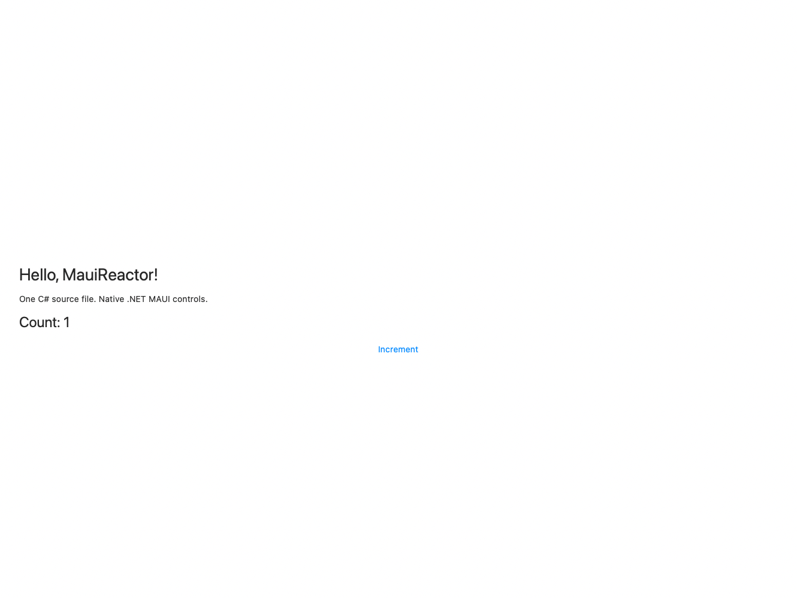

# MauiReactor.FileBased

Build a native .NET MAUI app in one C# file. Describe the UI with
[MauiReactor](https://github.com/adospace/reactorui-maui) control methods,
update component state, and run it with `dotnet run app.cs`.

```csharp
#:sdk Microsoft.Maui.Sdk.Reactor@0.1.0-local.3

public class CounterState
{
    public int Count { get; set; }
}

public class App : Component<CounterState>
{
    public override VisualNode Render()
        => ContentPage(
            VStack(
                Label("Hello, MauiReactor!").FontSize(28),
                Label("One C# source file. Native .NET MAUI controls."),
                Label($"Count: {State.Count}")
                    .FontSize(24)
                    .AutomationId("count"),
                Button("Increment", () => SetState(s => s.Count++))
                    .AutomationId("increment")
            )
            .Spacing(16)
            .Padding(32)
            .VCenter()
        );
}
```

That is the complete counter. You write the component while a small MSBuild SDK
supplies package references, native startup, application defaults, and the Apple
scene manifest. There is no user-authored project file or XAML.

Use this to try a UI idea, learn MauiReactor's state model, or share a small
native control example. The controls come from .NET MAUI, and the component
model comes from Adolfo Marinucci's MauiReactor.



**Experimental and source-only.** Mac Catalyst on Apple Silicon is the only
runtime-tested target. The SDK and template are not on NuGet.org. This is a
personal experiment derived from work in
[dotnet/maui-labs](https://github.com/dotnet/maui-labs), not an official
Microsoft or MauiReactor release.

## Run the counter

You need macOS, the .NET 10 SDK, its MAUI workload, and a compatible Xcode.
Run all commands from this checkout so that its `global.json` selects .NET 10.

```console
dotnet --version
dotnet pack src/MauiReactor.Sdk/MauiReactor.Sdk.csproj -o artifacts/feed
dotnet run samples/Counter/app.cs
```

Click **Increment**. The label changes from `Count: 0` to `Count: 1`.
`NuGet.config` connects the SDK resolver to the local package feed.
The [getting-started guide](docs/getting-started.md) covers workload setup,
the exact test environment, and troubleshooting.

**Toolchain limit:** runtime checks used .NET SDK 10.0.101 and workload set
10.0.102. The test machine had Xcode 27.2 while that workload required 26.2.
Checks used `-p:ValidateXcodeVersion=false`, which does not establish support
for this combination. Use a matched workload and Xcode for normal use.

## Create your own single-file app

From the checkout root, after packing the SDK:

```console
dotnet new install ./samples/Counter
dotnet new maui-reactor-file -n HelloReactor -o artifacts/HelloReactor
dotnet run artifacts/HelloReactor/app.cs
```

The template creates **only `app.cs`**. This output location inherits the local
feed and .NET 10 selection from the checkout. For an app outside this checkout,
configure the SDK feed and SDK version in a parent folder first.
Use the explicit file name; bare `dotnet run` does not discover this app on the
tested .NET 10 SDK.

The public root component must be named `App` in the global namespace.
Add directives when you need to change a default:

```csharp
#:property ApplicationTitle=MyCounter
#:property ApplicationId=com.example.mycounter
```

Quit the app, edit the source, then run it again. Code hot reload is not
integrated. The SDK includes DevFlow in Debug builds for UI inspection and
automation; [omit it](docs/getting-started.md#inspect-the-app-with-devflow)
with `#:property MauiReactorEnableDevFlow=false`.

## Know the limits

| Target or feature | Status |
|---|---|
| Mac Catalyst, Apple Silicon | Sample and template launch; counter interaction checked |
| iOS | Startup source included; build and runtime untested |
| Android, Windows, Linux | No startup implementation in this SDK |
| Hot reload | Not integrated; quit, edit, rerun |
| Icons, resources, signing, store packaging | Not configured |
| Published SDK or template | Not available; pack and install locally |

This app runs in its own native process. It does not need a companion app or
code-loading server. For a production app or more platforms, use
[MauiReactor's project template](https://github.com/adospace/reactorui-maui#quick-start)
and keep the same component style in a regular MAUI project.

## Explore the repository

| Path | Purpose |
|---|---|
| [`samples/Counter/`](samples/Counter/app.cs) | Runnable one-file counter and its `dotnet new` template definition |
| [`src/MauiReactor.Sdk/`](src/MauiReactor.Sdk/README.md) | Packable MSBuild SDK, startup source, and default manifest |
| [`docs/getting-started.md`](docs/getting-started.md) | Setup, directives, manifests, DevFlow, and platform limits |
| [`docs/blog-draft.md`](docs/blog-draft.md) | Detailed introduction and implementation notes |
| `artifacts/` | Ignored local packages, generated apps, and tools |

No generated binaries, package caches, or credentials belong in source control.
This project uses the [MIT license](LICENSE); dependency packages keep their own
licenses.
