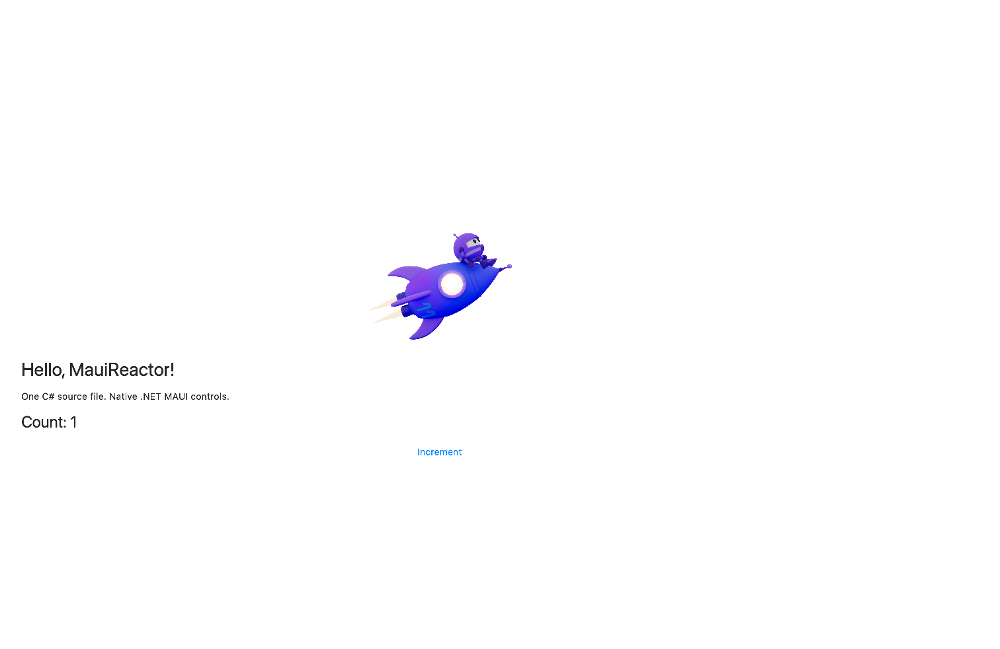

Write a native app in one C# file, describe the interface with methods, and run it
with `dotnet run app.cs`. That is the experience I wanted to try with
[MauiReactor](https://github.com/adospace/reactorui-maui).
For anyone asking for single-file graphical apps without XAML and with
React-style composition, this is a small, runnable place to start.

I have been exploring a related idea with
[Comet Go](https://github.com/dotnet/maui-labs/blob/main/src/Go/README.md). MauiReactor gives us another way to explore
the same authoring goal while keeping the native .NET MAUI control layer.
Adolfo Marinucci's library already provides the components, state updates, and
control methods. This experiment adds a small build SDK and a file-based
template around that existing work.

[alert type="important" heading="Experimental sample"]
This is an experimental preview. The SDK package is distributed through
GitHub Packages, not NuGet.org. The template is installed from this checkout.
Mac Catalyst is the only runtime-checked target.
The source includes iOS startup, but Android and Windows startup are not included.
[/alert]

## Start with the app

```csharp
#:sdk MauiReactor.FileBased.Sdk@0.1.0-preview.2

public class CounterState
{
    public int Count { get; set; }
}

public class App : Component<CounterState>
{
    public override VisualNode Render()
        => ContentPage(
            VStack(
                Image("dotnet_bot.png")
                    .HeightRequest(185)
                    .AutomationId("dotnet-bot"),
                Label("Hello, MauiReactor!").FontSize(28),
                Label("One C# source file. Native .NET MAUI controls."),
                Label($"Count: {State.Count}")
                    .FontSize(24)
                    .AutomationId("count"),
                Button("Increment", () => SetState(s => s.Count++))
                    .AutomationId("increment")
            )
            .Spacing(16)
            .Padding(32)
            .VCenter()
        );
}
```

That is the full user-authored application. The root component is a public
`App` class in the global namespace. The SDK supplies a `MauiReactor` namespace
import, so the component can use the library's inherited control methods.

The image is a normal file in `Resources/Images/` next to `app.cs`. The SDK
picks up `Resources/Images`, `Resources/Fonts`, and `Resources/Raw` the same way
a MAUI project does, and registers fonts for you. The bot is the .NET 11 MAUI
template artwork.

`ContentPage`, `VStack`, `Image`, `Label`, and `Button` are methods on the component API.
There is no need to write `new` for each control. The nesting still shows the
structure of the page, while methods such as `Spacing` and `Padding` describe
the layout.

The button callback calls `SetState`. MauiReactor then updates the label through
the native .NET MAUI control layer. The value lives in memory and resets when
the app exits, which is enough to check a real state-update path without adding
storage or services.

## Run with the preview SDK

From a checkout of this repository, first follow the
[GitHub Packages authentication steps](getting-started.md#authenticate-before-sdk-resolution).
GitHub requires a personal access token (classic) with `read:packages`, even
for public NuGet packages. Keep credentials out of source control.

```console
dotnet run samples/Counter/app.cs
```

You need the .NET 10 SDK, its .NET MAUI workload, and a compatible Xcode installation.
The sample includes a `global.json` to select .NET 10 and a `NuGet.config` that
routes the preview SDK to GitHub Packages before normal restore. The
[getting-started guide](getting-started.md) lists the exact package and tool
versions.

The SDK package holds the setup that would otherwise fill the top of the file:
the target framework, .NET MAUI settings, package references, application metadata,
native entry point, and default Apple scene manifest. It also registers
DevFlow for Debug builds so that we can inspect and exercise the app.

This uses [.NET file-based apps](https://learn.microsoft.com/dotnet/csharp/fundamentals/tutorials/file-based-programs).
The .NET SDK creates a virtual project and builds the app from it. The generated
app therefore needs no user-authored `.csproj` file, although the build still
uses MSBuild and produces a native app bundle.

## Keep platform setup in the package

My first version put every property, native delegate, and package reference in
`app.cs`. It worked, although the setup occupied more of the file than the
counter itself.

The custom SDK reduces the header to one directive:

```csharp
#:sdk MauiReactor.FileBased.Sdk@0.1.0-preview.2
```

An SDK is useful here because the target framework must be known before normal
package restore. A regular package that only adds late build targets cannot
replace that early setup. The
[.NET SDK implementation](https://github.com/dotnet/sdk/blob/v10.0.101/src/Cli/dotnet/Commands/Run/VirtualProjectBuildingCommand.cs)
writes file-based console defaults before importing the selected SDK, so this
SDK can change those defaults to a .NET MAUI target.

Apple scene setup is another detail worth keeping out of the counter. Apps built
with Apple SDK 27 need scene lifecycle metadata. The package supplies that
manifest and the .NET MAUI scene delegate. When you need custom metadata, add a
property that points to your own manifest:

```csharp
#:property AppBundleManifest=MyInfo.plist
```

The default is a starting point for the prototype. Your manifest can add
permission descriptions and other settings when the app needs them.

## Create another app from the template

From the checkout root:

```console
dotnet new install ./samples/Counter
dotnet new maui-reactor-file -n HelloReactor -o artifacts/HelloReactor
cd artifacts/HelloReactor
dotnet run app.cs
```

The template creates only `app.cs`. This output folder inherits the sample's
feed and .NET SDK selection. You can generate into another folder once
you configure those prerequisites there.

Use the file name in the run command. Bare `dotnet run` did not find the
file-based app on the .NET 10 SDK used for this experiment.

The SDK uses the source folder name for the application title. Add normal
file-based directives when you want to change a default:

```csharp
#:property ApplicationTitle=MyCounter
#:property ApplicationId=com.example.mycounter
```

Additional dependencies can use `#:package Package.Name@version`. The
[SDK contract](../src/MauiReactor.Sdk/README.md) lists the version properties and the
DevFlow opt-out.

## Check the behavior through the app

I checked both the sample and a fresh template output on Mac Catalyst.
DevFlow found the native label and button through their automation identifiers.
It tapped **Increment** and asserted that the label changed from `Count: 0` to
`Count: 1`.



The runtime checks used .NET SDK 10.0.101, workload set 10.0.102,
Reactor.Maui 4.0.18, and Microsoft.Maui.Controls 10.0.41.
The machine had Xcode 27.2, while its Apple workload required Xcode 26.2.
I used `-p:ValidateXcodeVersion=false` for the local check. That bypass is a
limitation of this evidence, so use a matched workload and Xcode for your setup.

The checks also covered the custom manifest property and the Debug DevFlow
opt-out. Release evaluation excludes the agent reference. This does not yet
cover store packaging, signing, or runtime behavior on another platform.

## Understand the current edit loop

Quit the app, edit the source, and run it again. The .NET SDK rebuilds changed
source, while MauiReactor handles state updates during execution.

Code hot reload is separate from those state updates. MauiReactor already has
an established project-based hot reload tool, but that tool opens a `.csproj`
through an MSBuild workspace. This sample has not connected that tool to a
file-based virtual project. I also have not checked `dotnet watch` here.

This app runs as its own native process. It does not use Comet Go's server,
companion app, or network code-loading path. Keeping those approaches separate
lets the sample use MauiReactor without changing Comet.

## Move beyond the counter

The [sample and template](../README.md) give you a small place to try
MauiReactor's control methods and state model. The
[detailed guide](getting-started.md) covers directives, manifests, feeds,
platform limits, and the exact runtime checks.

For an app that needs more platforms, an app icon, signing, or the established hot
reload workflow, start with MauiReactor's
[`Reactor.Maui.TemplatePack`](https://github.com/adospace/reactorui-maui#quick-start)
and move the component into that project. You can keep the same style of UI
code as the app grows.
